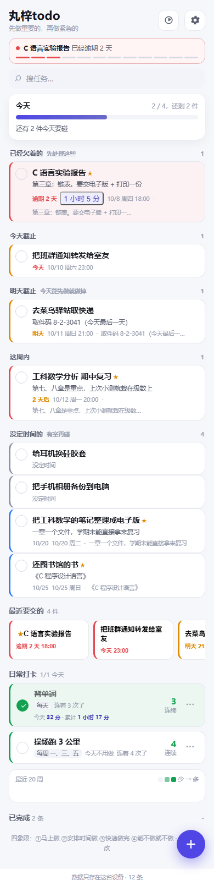
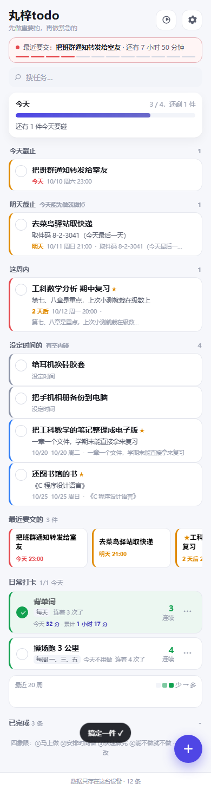
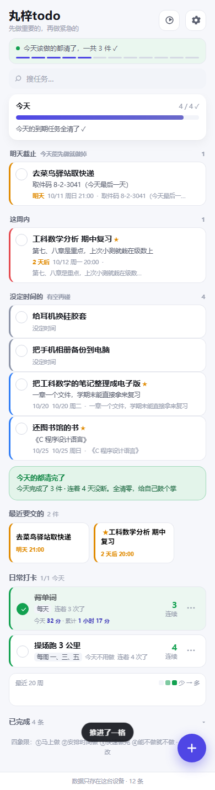
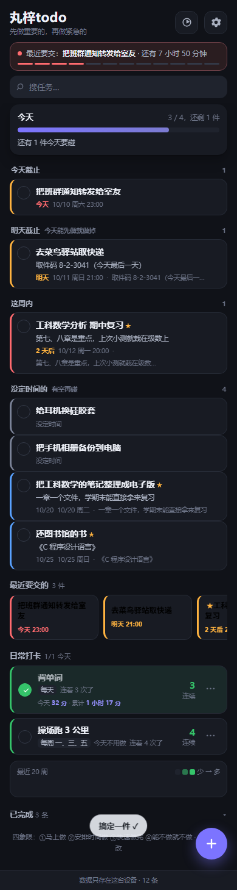

# 丸梓todo（今天要做什么）

**先做重要的，再做紧急的。**

一个手机上的待办清单。打开先看到**今天这一屏** —— 已经欠着的、今天截止的、明天截止的，从上往下一组一组排好，像一张手写便条；想知道全局就切到**四象限**（艾森豪威尔矩阵），它自己按"重要 / 紧急"把事分开。

纯静态单页，没有任何后端和外部依赖 —— 可以直接传到 GitHub Pages，然后用 iPhone 的 Safari「添加到主屏幕」，用起来和一个 App 没区别。**电脑关了照样能用。**

**线上地址：<https://627741714-dot.github.io/wanzi-todo/>**（iPhone 用 Safari 打开 → 分享 → 添加到主屏幕）

---

## 先看效果

| 今天（默认，只有今天要碰的） | 勾掉一件，飘一句 |
| --- | --- |
|  |  |

| 收工结算 | 四象限（想全局看的时候） |
| --- | --- |
|  |  |

| 清单 | 暗夜 |
| --- | --- |
|  |  |

| 鼓励的话（可以自己写） | 搜索 |
| --- | --- |
|  |  |

| 计时（整屏只剩这一件事） | 每件事花了多久 |
| --- | --- |
|  |  |

都是 iPhone 真实宽度 390px 用无头 Edge 实拍的，不是设计稿。更多截图在 `预览/`（共 20 张）。

---

## 它按什么排序

### 四象限（艾森豪威尔矩阵）

|  | 紧急 | 不紧急 |
| --- | --- | --- |
| **重要** | ① 马上做 | ② 安排时间做（最该投入） |
| **不重要** | ③ 快速做完 | ④ 能不做就不做 |

"紧急"的界线默认是**三天以内（含已经逾期的）**，可以在设置里改成任意天数。

### 分数（`scoreOf`）

```
分数 = (999 − 剩余天数) × 100 + (重要 ? 50 : 0)
```

- 剩余天数超过 ±999 天就被截到 999（防溢出），所以分数最小 0、最大 199850。
- **没填截止时间的任务一律 0 分**，永远排在最后 —— 没期限的事不该插队。
- 「重要」只值 50 分，也就是**半天**：它只在截止日期相同时才起作用（同一天的两件事，重要的排前面）。这是故意的 —— 四象限里"紧急"和"重要"本来是两根轴，但排序得是一维的，所以让时间当主序、重要性当微调。
- 一律用整数算，没有浮点误差。
- 分数一样时按"添加时间 → id"兜底，保证顺序稳定（不会每次刷新都跳来跳去）。

三种排序方式可选：**自动算分**（默认）/ **只看 DDL** / **按添加时间**。

### 周期性任务

有些事情是每天、每周固定几天、或者每隔几天必须做的（背单词、跑步）。这类任务：

- **只出现在"今天"和"日常打卡"区里，不参与四象限排序**（它没有"截止"这回事）；
- 勾一下是**打卡**，不是"完成" —— 今天勾了，明天还在；
- 有**连续天数**统计（今天还没过完时，从昨天接着数，不会因为你上午没勾就断）；
- 有**小热力图**：过去几周哪天该做、哪天做了，一眼看出来。

三种周期：`每天`、`每周的几天`（周一到周日随便选）、`每隔几天`。

---

## 跑起来

**电脑上直接看**：双击 `丸梓todo.html` 就行（但 `file://` 下 Safari 不让存数据，加了任务一关就没）。

**手机上打开**：双击 **`启动.bat`**，它会打印一个局域网地址（形如 `http://192.168.x.x:5177`），手机连同一个 WiFi，用 Safari 打开这个地址。

**发布**：把 `index.html` 和 `icon-180.png` 传到 GitHub Pages 就行（`index.html` 就是打包好的单文件版，静态托管首页必须叫这个名字）。也可以直接把 `丸梓todo-单文件版.html` 发给别人。

### 文件结构

```
wanzi-todo/
├─ 丸梓todo.html             开发版（引用 src/ 下的 css/js）
├─ 丸梓todo-单文件版.html     打包产物：0 外部引用，发人用
├─ index.html               打包产物：同上，传 GitHub Pages 用
├─ icon-180.png             iPhone 主屏图标（手写 PNG 生成，不依赖图片库）
├─ 启动.bat                  局域网预览（纯 ASCII）
├─ src/
│  ├─ data.js               静态数据：四象限文案、主题、排序方式、默认设置（UMD）
│  ├─ todo-core.js          纯逻辑：日期算术、算分、四象限、重复任务、打卡、增删改、规范化
│  ├─ app.js                渲染与交互：列表、抽屉、备份恢复、存储探针
│  └─ style.css             3 套配色（清爽 / 纸感 / 暗夜）
├─ tools/                   打包、自检、测试、截图、本地服务
│  ├─ build-single.mjs      把 html+css+js 内联成单文件版
│  ├─ check-dist.mjs        交付自检（74 项）
│  ├─ smoke.mjs             逻辑冒烟（262 项）
│  ├─ dom-smoke.mjs         界面冒烟（jsdom 真跑页面点一遍，266 项）
│  ├─ reverse-check.mjs     反向验证：故意改坏源码，确认指定断言真的变红
│  ├─ shots.mjs             用无头 Edge 实拍 13 张截图（CDP 强制 390px）
│  ├─ cdp.mjs               极简 CDP 客户端（Node 自带 WebSocket，零依赖）
│  ├─ make-icon.mjs         手写 PNG 生成图标
│  ├─ push-via-api.mjs      github.com:443 连不上时，用 GitHub API 把改动推上去
│  └─ serve.mjs             零依赖本地静态服务
└─ 预览/                     实拍截图
```

---

## 用起来

- 右下角 **＋** 加一条：名字、备注、重要不重要、截止时间（有「今天 / 明天 / 这周内 / 不定」四个快捷键）、周期。
- 点任务左边的圈**勾掉**；点任务本身**改它**。
- 顶上搜索框：输两个字就筛，命中的字会高亮；搜索时四象限收起来、只留结果。
- 底部「已完成」折叠区：归档做完的事。
- 顶部一条状态行：今天几件、逾期几件、最近要交的是什么。

### 今天这一屏（默认）

打开第一眼看到的就是它，只有和「今天」有关的事，按欠账程度从上往下分五组：

| 组 | 什么时候进这一组 |
| --- | --- |
| 已经欠着的 | 截止时间已经过了 |
| 今天截止 | 就是今天 |
| 明天截止 | 明天（这一组是给你提前量的） |
| 这周内 | 7 天内（天数可以在设置里看成"最近要交的"） |
| 没定时间的 | 压根没填截止时间 |

顶上一条**进度条**：`2 / 4，还剩 2 件`，下面跟一句人话（"还有 2 件今天要碰"）。今天该做的都清了，进度条下面那条变成**收工结算** —— `今天的都清了 / 今天完成了 3 件 · 连着 4 天没断。全清零，给自己鼓个掌`，状态行也跟着说「今天该做的都清了，一共 3 件 ✓」。

**勾掉的时候会有点响动**：勾勾弹一下，紧接着从底下飘一句鼓励（"搞定一件 ✓""推进了一格"）。设置里能关掉（有人嫌吵）。

### 计时（这件事花了多久）

右上角那个**秒表**是入口。点它，如果不是在计时，先让你**挑一件事**（只列还没做完的 + 今天该打卡的日常），选完就进**整屏专注**：屏幕中间一个大数字，上面是这件事的名字，底下就一个「做完了」。这一屏盖住所有别的东西 —— 它的意思就是"现在只有这一件"。

- **同一时间只能计一件**。想换事得先「换一件事」（先把当前这段结了，再挑下一件）。
- 停下来的那一刻落一条记录（`sessions`），并飘一句「记下了：42 分」。**5 秒以下不记**，但会说一声「太短了，不记」—— 手滑点一下不该在列表里留一条。
- **任务行上会挂一枚时长小标签**（`1 小时 5 分`）；正在计的那一件变成亮色的活秒表。点这枚标签能看**这一次次的记录**，每条能**改长短**（点一下弹个分钟数）也能**删掉**。
- **忘了停也不会记出个天文数字**：单段封顶 24 小时。而且**下次打开会问一句**「刚才还在计时：某某已经计了 38 分，现在结束并记下来？」—— 点取消就把这段丢掉。
- **日常打卡的累计**：打卡行里会写 `今天 32 分 · 累计 1 小时 17 分`。热力图除了"哪天打过卡"，还会**按当天累计分钟再压深一层**（10 分钟 / 半小时 / 1 小时 / 2 小时以上），鼠标停在格子上能看到具体时长。

**为什么时长一定是"时间戳相减"**：iPhone 上把网页加到主屏幕之后，切后台或者锁屏会把 `setInterval` 冻住，靠"每秒加一"的计时器锁屏十分钟只会走十秒。所以代码里只存一个 `startedAt`，显示的时候现算 `当前时间 − startedAt`。定时器只负责**让数字看着在走**，不负责计时长。跨零点睡觉也不会算错。

### 鼓励的话

设置里有一段**「鼓励的话」**文本框，换行分隔，最多 20 行、每行 40 字。写了就**只用你写的**，不再随机播自带的那几句；留空就用自带的三个池子（勾掉一件时说的 / 每日结算时说的 / 连续打卡时说的，后者可以用 `{n}` 代替天数）。

### 设置（点右上角）

3 套配色（**清爽**为默认 / 纸感 / 暗夜）、默认视图（**今天**为默认 / 四象限 / 清单）、排序方式、紧急界线（几天算紧急）、鼓励的话、勾掉时要不要弹那句。

设置存在 `localStorage`，**启动时会主动探一次**能不能写、写进去会**立刻读回来逐字节比对**，不一致就在页面顶部弹一条醒目的红条说明原因 —— 绝不静默降级。（为什么要在启动时就探：一个空清单的新用户在隐私模式下，如果只在保存时才检查，他会看到一切正常，直到辛苦记了一堆任务才发现存不住。）

设置抽屉最下面还有**备份**：把全部任务和设置导出成 JSON 文件、或复制到剪贴板，再反过来粘贴/选文件**合并恢复**或**完全替换**。手机换新、清过 Safari 数据之后，用它把数据弄回来。

---

## 数据长什么样

存在 `localStorage` 的 `wanziTodo.v1` 里，就是一段普通 JSON：

```json
{
  "version": 1,
  "seq": 12,
  "items": [
    {
      "id": 1,
      "title": "C 语言实验报告",
      "note": "第三章：链表。要交电子版 + 打印一份",
      "important": true,
      "done": false,
      "deadline": { "date": "2026-10-08", "time": "18:00" },
      "repeat": null,
      "log": [],
      "sessions": [
        { "start": 1759917600000, "end": 1759920000000, "ms": 2400000 }
      ],
      "createdAt": 1759281120000,
      "updatedAt": 1759281120000
    }
  ],
  "settings": { "theme": "clean", "view": "focus", "sort": "auto", "soonDays": 7, "urgentDays": 3, "cheers": "", "celebrate": true },
  "timer": { "taskId": 3, "startedAt": 1759924200000 }
}
```

- `deadline` 可以为 `null`；`time` 可以是空串（只记得哪天，不记得几点）。
- `repeat` 形如 `{"kind":"daily"}` / `{"kind":"weekly","days":[1,3,5]}` / `{"kind":"every","n":3}`；周期任务的完成记录在 `log`（一串 `YYYY-MM-DD`），它自己的 `done` 永远是 `false`。
- `sessions` 是**一段一段的计时**（`start` 开始的毫秒时间戳、`end` 结束的、`ms` 时长）。没计过时就是没有这个字段。
- `timer` 是**正在走的那一段**；没在计时就是 `null`。它指向的任务要是被删了，`normalize()` 会把它清掉。
- 读到脏数据不会崩：`normalize()` 会丢掉坏记录、把 `seq` 抬到不小于最大 id（但**绝不倒退**，否则下一条的 id 会撞上已经删掉的号）。

---

## 几个踩过的坑（都固化成代码或测试了）

**日期一律用本地时间构造。** `new Date('2026-10-10')` 会被当成 UTC 午夜，东八区整体偏一天，"今天"和"逾期"全错。代码里统一用 `new Date(y, m - 1, d)`，`check-dist.mjs` 里有一条断言守着（逐行查、跳过注释）。

**周几要用 1–7，周日是 7 不是 0。** `getDay()` 返回 0–6，直接拿来跟"每周的几天"比，周日会永远匹配不上。代码里统一走 `isoDow()`。

**源码注释里不要写完整的 `</body>` 或 `</script>`。** 打包脚本是靠字符串替换 `</body>` 往里插东西的，注释里出现一次就会**插到注释中间** —— 页面看着一切正常，但注入的脚本静默不执行，排查了很久。同理内联的 js 里出现 `</script` 会被当成提前闭合（打包脚本会把 `</script` 打散成 `<\/script`，但那只对真的出现在 js 里有效）。

**`[hidden]` 必须带 `!important`。** `.mask{display:flex}` 这类规则会盖掉浏览器默认的 `[hidden]{display:none}`；而且 jsdom 的 `getComputedStyle` 查不出这个坑，所以用 CSS 源码断言守着。

**暗夜主题下浅字压浅底。** 次级文字一律用 `color-mix(in srgb, …)` 现算，不要引用一个"在浅色主题下才好看"的固定灰。

**启动别等 `DOMContentLoaded`。** 最开始 `boot()` 挂在 `DOMContentLoaded` 上，结果测试脚本 eval 完三个 js 后立刻查 `state`，看到的是一份**空的初始文档**，排查半天以为 `normalize` 坏了。改成"立即启动 + 挂一个兜底"。

**少一个节点要当场报名字。** `el` 里 60 多个 id，敲错一个（把 `edClose` 写成 `editClose`）的症状是某处莫名其妙的 `undefined` 报错。现在 `assertNodes()` 会在启动第一行点名缺了哪些 id。

**`probeStorage()` 要主动探，不能等保存时才发现。**

**测试里读 DOM 一律走守卫读取器。** `p.txt(sel)` 取不到就返回 `'<missing …>'`。直接用 `p.$('#x').textContent` 时，页面一旦被改坏就是 `TypeError` 把进程打死、后面的断言全跑不到 —— 反向验证就分不清"真红了"还是"崩了"。

**别用 PowerShell 回写源码。** `Set-Content -Encoding UTF8` 会写 BOM，BOM 被内联进 `<style>`/`<script>` 中间会被当成选择器/标识符，把紧随的内容整块吃掉。改源码一律用编辑器或 Node 写文件。（这条是**真的踩过**：一个测试文件被这样毁过一次，中文全成乱码、连字符串引号都被替换掉、语法都不通过，只能重写。）

**`.bat` 里不能有中文。** cmd.exe 用 GBK 读 bat，UTF-8 中文会乱码并把命令拆坏。启动脚本保持纯 ASCII，中文提示交给 Node 打印。

**Edge 无头模式在 Windows 的最小窗口宽度约 518px。** `--window-size=390` 无效，套一个 390px 宽的 iframe 也会被撑到 518。要拍真正的手机宽度必须走 CDP 的 `Emulation.setDeviceMetricsOverride`。

**截图脚本的演示数据要种进 `localStorage`。** 用 `Page.addScriptToEvaluateOnNewDocument` 在页面脚本执行**之前**写好存档，这样它是"真的从存档读出来的"，而不是硬塞进内存的假状态。

---

## 测试

```bat
node tools/smoke.mjs         :: 纯逻辑：321 项
node tools/dom-smoke.mjs     :: 用 jsdom 真跑页面并点一遍：359 项
node tools/build-single.mjs  :: 打包
node tools/check-dist.mjs    :: 交付自检：74 项
node tools/shots.mjs         :: 实拍 20 张截图到 预览/（顺带自检有没有横向溢出）
node tools/shots.mjs --check :: 只自检不写图
```

`dom-smoke` 找不到 jsdom 会优雅跳过（不会报看不懂的错）。

### 反向验证：证明测试不是摆设

```bat
node tools/reverse-check.mjs
```

它会对 `src/app.js` / `src/todo-core.js` 逐个做 **17 处**破坏（比如把 `scoreOf` 直接改成 `return 0;`，或者把计时改成 `var ms = 0;`），每破坏一次就跑一遍界面测试，要求**名字指定的那条断言真的变红**，然后立刻还原。一条"永远为真"的假守卫比没有断言更糟，这个脚本就是用来抓它的。

已经抓出来过的两条：

- 「恢复之后写进 localStorage 了吗」原来只检查 key 在不在，而导出按钮早就把 key 写进去了 —— 把恢复逻辑里的保存删掉，它照样是绿的。改成断言**存进去的值**才会红。
- 把"标题不能为空"的判断改成 `if (false)`，测试**照样全绿** —— 因为逻辑层还会再拦一次，兜底文案一模一样。这条改成了直接替换掉提示文案本身，才能分辨。
- 计时那几条也踩过一次：破坏以后进程在半路抛错打死，连"哪条红了"都打印不出来，反向验证看到的是 `MISS` 而不是 `RED`，分不清是"没守住"还是"崩了"。所以第 21 组里凡是依赖前面步骤的取值，都用 `tryClick` / `sess()` / `timerOf()` 这类**不会抛错**的读法，让失败老老实实变成一条红断言。

**跑反向验证的两个安全网**（都吃过亏）：
1. **开工前体检**：先确认源码里有几处必须存在的标记，缺了就拒绝运行 —— 因为曾经有一次运行被中断，源码里留下了破坏态，之后每次都拿"已经被改坏的磁盘文件"当正确版本，破坏被一路固化。
2. **快照 + 还原**：干净源码另存一份，每次破坏后无论如何都还原；**不要把 `reverse-check.mjs` 和别的会改源码的命令串在同一条 PowerShell 命令行里跑**（这是一次事故的直接触发条件）。

---

## 手机安装（iOS）

1. 先在电脑上 `启动.bat`，手机 Safari 打开那个局域网地址，确认能看到、能加一条任务。
2. 传到 GitHub Pages 之后，用 Safari 打开 Pages 地址 → 点「分享」→「添加到主屏幕」。
3. 图标和名字都配好了（`apple-touch-icon`、`apple-mobile-web-app-title`），打开就是全屏，没有浏览器地址栏。
4. **加了任务之后，偶尔用设置里的「导出文件」存一份**。数据只在这台手机的浏览器里，删了 App 或清了 Safari 数据就没了。

### 重新部署

改完代码之后：

```bat
node tools/build-single.mjs   :: 一定先打包，否则推上去的还是旧的 index.html
node tools/check-dist.mjs     :: 确认产物没问题
node tools/push-via-api.mjs --message "改了啥"
```

Pages 会自动重新发布（大约半分钟到几分钟）。仓库是 `627741714-dot/wanzi-todo`，Pages 源是 `master` 分支根目录，线上地址 <https://627741714-dot.github.io/wanzi-todo/>。

`push-via-api.mjs` 走 GitHub 的 Git Data API（`api.github.com`）把改动过的文件建成 blob → tree → commit，再更新 `master` 分支 —— 效果和 `git push` 一样（这个网络里 `github.com:443` 经常连不上，见下）。
- `--dry` 只看会推哪些文件。
- `--delete` 顺手删掉远端已经不该有的文件（默认不动它们，免得手滑清空远端）。
- 它跟**远端当前 sha**比，不是跟本地 `origin/master` 比：API 推出来的提交本地根本没有，本地跟踪分支会一直停在老位置，拿它当基准每次都会重推一遍全部文件。
- **中文文件名注意**：`git` 默认把中文路径写成 `"\344\270\270..."` 这种转义形式，拿它去 `fs.existsSync` 永远找不到 —— 早期这工具就是这样把 18 张截图和 `丸梓todo.html` **静默漏掉**的（不报错，只说"推了 11 个文件"）。所以脚本里一律 `-c core.quotepath=false` + `-z`（NUL 分隔）读 git 输出。改这个工具时别把这层去掉。
- 这个网络里 `api.github.com` 也会时不时 `ECONNRESET`，所以每个请求都带 4 次指数退避重试。

另一个已知现象：`ssh github.com:22` 通但会 `Permission denied (publickey)`（本机密钥没加到账号），所以别指望走 SSH。

### 三个一定会遇到的坑

- **必须用 http(s) 打开。** `file://` 下 Safari 不允许存数据，加的任务一关就没。
- **Pages 的响应头带 `max-age=600`。** 更新之后手机上可能十分钟内还是旧版。绕开办法：地址后面加个 `?v=2`、`?v=3`。
- **别用「清除 Safari 历史记录与网站数据」来刷新。** 那会把 `localStorage` 一起清掉，任务全没了。刷新页面用下拉或者关掉重开。
- 发给同学的话，发 **`丸梓todo-单文件版.html`**（一个文件，双击就能看）。
